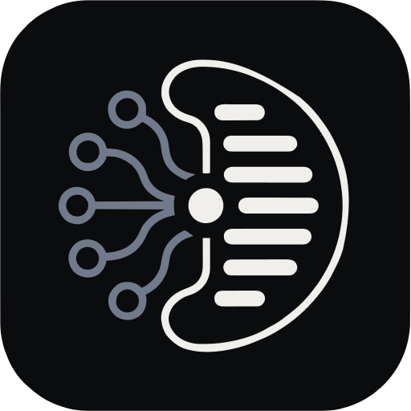

  
  <h1>Comind</h1>
  
<b>Private. Local-first. AI proposes, you review.</b>

  

    
    
    
  

---

> [!NOTE]
> Early work in progress — this README is a placeholder and will change.

A block-based knowledge base that stays on your machine. The AI suggests
changes; nothing lands until you review and accept them.
